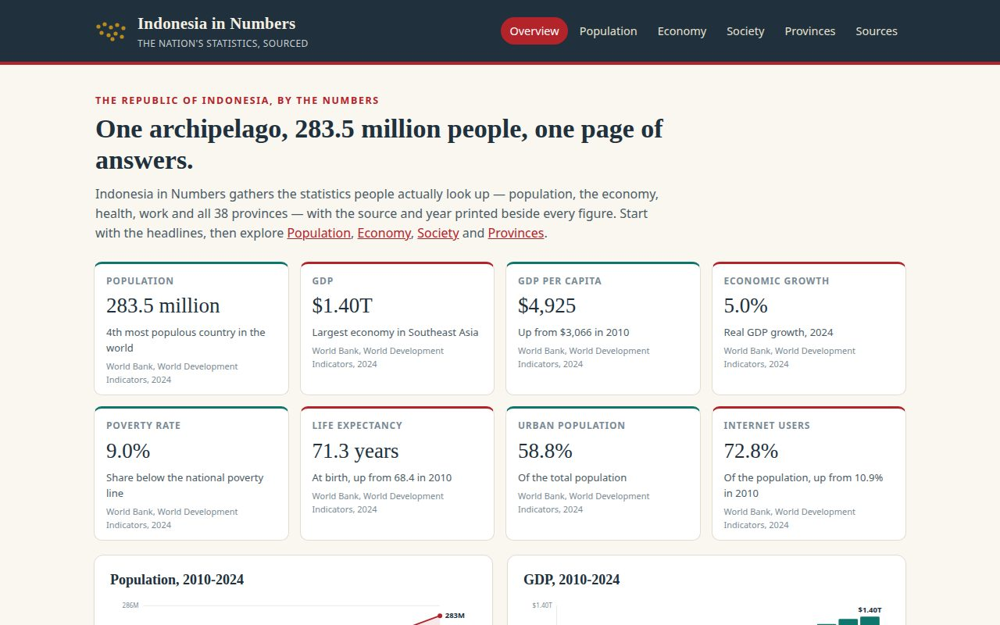
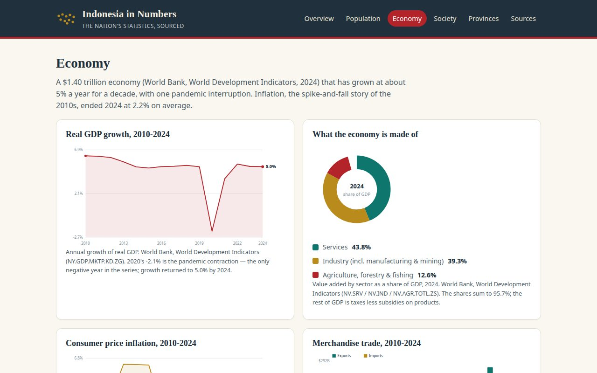
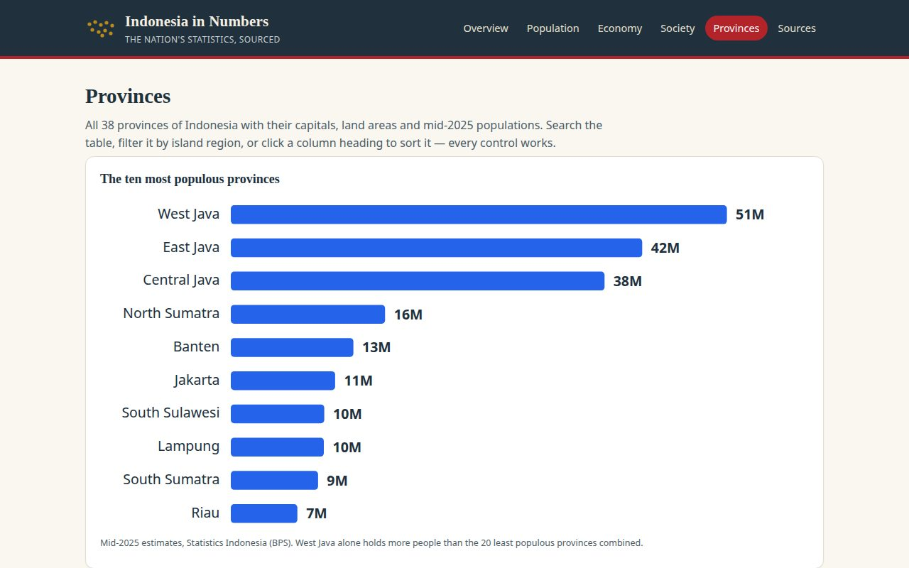
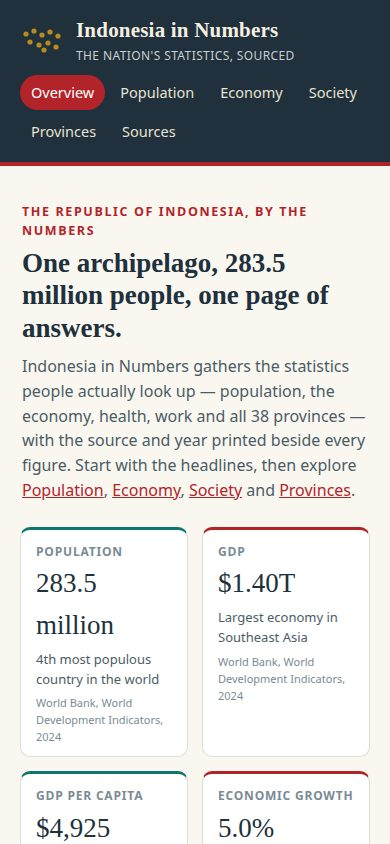

# Indonesia in Numbers — a national statistics site

[](https://make.fun/bounty/best-national-statistics-site-20261126-0539)
[](https://make.fun/bounty/best-national-statistics-site-20261126-0539)
[](https://make.fun/bounty/best-national-statistics-site-20261126-0539)



**Indonesia in Numbers** is a complete national statistics site for the Republic of Indonesia, built as plain static files — no build step, no framework, no network requests. Six sections answer what visitors actually look up: headline indicators on the overview, then Population, Economy, Society, a fully searchable and sortable table of all 38 provinces, and a Sources & method page. Every figure carries its source and year next to it, and every chart is drawn by the site's own SVG code.

## At a glance

| | |
| --- | --- |
| Site | Indonesia in Numbers — national statistics for Indonesia |
| Sections | Overview · Population · Economy · Society · Provinces · Sources & method |
| Coverage | 17 national indicator series, 2010–2024 · all 38 provinces (mid-2025) · age structure and GDP by sector |
| Data | World Bank, World Development Indicators (retrieved 26 Nov 2026) · Statistics Indonesia (BPS) |
| Charts | 12 charts drawn in hand-written SVG — line, bar, grouped bar, ranked bar, donut |
| Interactive | Province table with live search, island-region filter chips and click-to-sort columns |
| First load | 6 files, 15,700 bytes gzipped — no framework, system fonts only |
| Runs | Any static file server; works fully offline |

## Screenshots


*Economy — growth 2010–2024 (the −2.1% pandemic year in plain sight) and the sector donut: services 43.8%, industry 39.3%, agriculture 12.6%.*


*Provinces — West Java's 50.8 million people lead the ranked bars; below sits the complete table with search, region filters and sortable columns.*


*The same overview on a phone — the layout is responsive and every chart redraws at phone width.*

## What is inside

- **Overview** — eight headline KPIs (population 283.5M, GDP $1.40T, growth 5.0%, poverty 9.0%, life expectancy 71.3 years, urban share 58.8%, internet users 72.8%…), population and GDP charts, the ten largest provinces, and the country in one paragraph.
- **Population** — growth 2010–2024, the age-structure donut, urbanisation, and where everyone lives.
- **Economy** — real growth, GDP by sector, inflation, merchandise trade (exports vs imports), GDP per capita, and an honest two-number treatment of unemployment (ILO modelled 3.3% vs BPS open unemployment 4.76%, Feb 2025 — both shown, both labelled).
- **Society** — poverty, life expectancy (including the pandemic dip), the internet adoption curve, literacy, and the BPS Human Development Index.
- **Provinces** — all 38 provinces with capital, island region, land area, mid-2025 population and density; search, filter and sorting all work in the browser.
- **Sources & method** — where every number came from, and how to re-check it: the World Bank indicator code for each series is written beside it in `app/data.js`.

## Run it

```sh
node serve.ts            # serves app/ at http://localhost:8080
```

or hand the site in the way the grader does:

```sh
mkdir -p out && MAKEFUN_OUTPUT_DIR=out node main.ts   # copies app/ + screenshots/ to out/ and writes out/dossier.json
```

## Files

- `app/index.html` — the page shell and masthead; `app/style.css` — the whole design (warm-paper annual look, system fonts)
- `app/data.js` — every figure the site shows, each with its source named; the one file to audit
- `app/charts.js` — the SVG chart builders (line, bar, grouped bar, ranked bar, donut)
- `app/views.js` — one render function per section, plus the provinces table controls
- `app/main.js` — the hash router
- `main.ts` — the hand-in program: copies `app/` and `screenshots/` to the output folder and writes `dossier.json` with the vendored make.fun library (`vendor/makefun-frontend.ts`, the kit's own file, byte for byte)
- `screenshots/` — real renders of the site, taken with headless Chrome at desktop and phone sizes; `shots.json` records how

## License

MIT — see `LICENSE`.

Built for the [Best National Statistics Site](https://make.fun/bounty/best-national-statistics-site-20261126-0539) bounty on [make.fun](https://make.fun).
